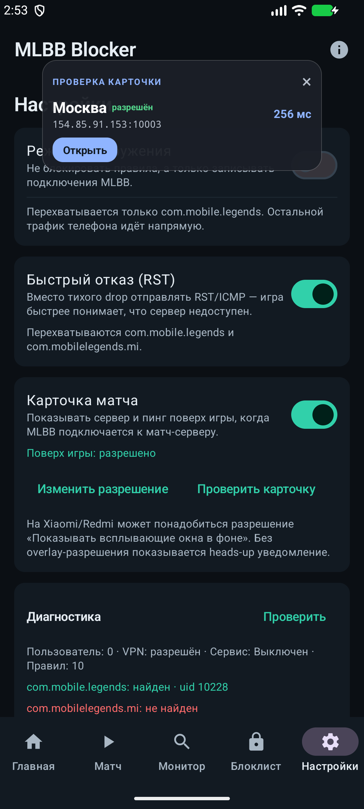

# MLBB Blocker

<p align="left"></p>

Локальный фильтр серверов **Mobile Legends: Bang Bang** для Android. Приложение поднимает VPN только для MLBB, блокирует нежелательные IP и помогает выбрать сервер в нужном регионе.

- Без удалённого VPN-сервера: трафик не уходит третьим лицам.
- Без аналитики и аккаунтов: правила, история и пинг хранятся на телефоне.
- Через `VpnService` + `sing-box` (libbox), только пакеты `com.mobile.legends` и `com.mobilelegends.mi`.

## Возможности

- **Профили Москва / ДВ / Новосибирск** на главной странице.
  - «Москва» — разрешает московские матч-серверы, остальные матч-порты блокирует.
  - «ДВ» — блокирует дальние регионы, оставляет Хабаровск и Владивосток.
  - «Новосибирск» — разрешает только новосибирские матч-серверы.
- **Карточка «Матч найден»** поверх игры: город, IP:порт, профиль, пинг и статус. Есть кнопка «Разрешить 5 мин».
- Если показ поверх игры запрещён — приходит heads-up уведомление.
- **Монитор серверов**: все IP подключений MLBB, фильтры по регионам, TCP-пинг и джиттер, блокировка IP или /24.
- **GeoIP офлайн**: встроенная DB-IP Lite City (IPv4).
- **История**: Room, матчи, заблокированные попытки.
- **Проверка обновлений** через GitHub Releases, загрузка APK в приложении и установка через PackageInstaller.
- **Резервная копия**: JSON-экспорт/импорт профиля, правил, исключений и истории.
- **Правила с сервера**: порты, профили и известные серверы лежат в подписанном `rules.json`; приложение проверяет подпись сертификатом APK и раз в сутки обновляет правила. При любой ошибке остаётся последний рабочий набор.
- **Самовосстановление**: после обновления APK VPN поднимается сам, при падении сервиса — одна повторная попытка и уведомление с кнопкой «Включить».
- **Незнакомые порты**: если MLBB начнёт использовать новый порт, придёт уведомление с выбором «матч-порт / сервисный / игнорировать».
- **Экспорт** списка IP и импорт блоклиста.
- Сервисные порты **30021, 30071, 30190, 30220** не блокируются: игра использует их для проверки серверов.
- Основной сервер подключения **154.85.91.151:10003** по умолчанию разрешён и не показывает карточку. Его можно блокировать переключателем в настройках.
- Короткие стартовые подключения не показывают карточку, только если они разрешены: заблокированные матч-серверы показываются всегда.



## Установка

1. Скачайте APK из [Releases](https://github.com/mrkoronalol/mlbb-blocker/releases/latest).
2. Установите и выдайте разрешение VPN.
3. Для карточки поверх игры разрешите «Поверх других приложений» в настройках приложения.
4. Для уведомлений разрешите уведомления (Android 13+).
5. Выберите профиль и включите блокировку **до** поиска матча.

APK в Releases подписан release-ключом; GitHub Actions проверяет сборку тестами и lint. Для обновления поверх версии с той же подписью данные сохраняются. Если ранее была установлена debug-сборка, её нужно удалить перед установкой release APK — иначе Android откажет из-за другой подписи.

## Сборка

Требования: JDK 17, Android SDK 35, Git.

```powershell
# libbox.aar не хранится в репозитории из-за размера
powershell -ExecutionPolicy Bypass -File .\scripts\fetch-libbox.ps1

# укажите путь к SDK
"sdk.dir=C\:\\Users\\<user>\\AppData\\Local\\Android\\Sdk" | Set-Content local.properties

.\gradlew.bat :app:assembleDebug
```

APK: `app/build/outputs/apk/debug/app-arm64-v8a-debug.apk`.

## Как это работает

1. VPN-сервис перехватывает только трафик MLBB.
2. Разрешённые адреса идут напрямую.
3. Заблокированные адреса уходят в локальный `sink` и не покидают устройство.
4. В профилях «только Москва» и «только Новосибирск» разрешён выбранный регион, остальные матч-порты (`10003`, `5000–5058`, `5500–5599`, `10011–10013`, `10063`) блокируются.
5. Логин и служебный трафик не блокируются, чтобы игра могла запуститься.

## Данные и лицензии

- GeoIP: [DB-IP Lite City](https://db-ip.com), лицензия [CC BY 4.0](https://creativecommons.org/licenses/by/4.0/), сборка [sapics/ip-location-db](https://github.com/sapics/ip-location-db).
- VPN-ядро: [sing-box](https://github.com/SagerNet/sing-box) / [libbox](https://github.com/singbox-android/libbox).
- UI: Kotlin, Jetpack Compose, Room, MaxMind DB Reader.

## Лицензия

Проект распространяется по **GNU GPL v3.0** (см. [LICENSE](LICENSE)). Это связано с использованием GPL-компонентов sing-box/libbox. Исходный код доступен в этом репозитории.

## Ограничения

- Приложение не меняет регион аккаунта и не обходит ограничения издателя.
- Блокировка IP не гарантирует выбор конкретного матч-сервера.
- На некоторых прошивках (Xiaomi/Redmi) нужно дополнительно разрешить «Показывать всплывающие окна в фоне».
- Проект не связан с Moonton. Используйте на свой риск.

## Обновления

Приложение проверяет последний релиз на GitHub и показывает карточку с кнопкой скачивания. Уведомление о новой версии приходит один раз для каждой версии.
